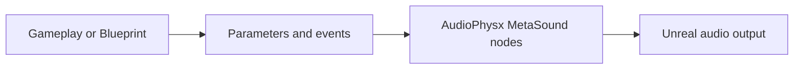

# Make game audio respond to the world

**AudioPhysx** brings purposeful playback tools, physically inspired audio processing and world-aware Blueprint helpers into Unreal Engine. Build sound that reacts to distance, materials, motion and player actions—without turning every MetaSound into a maze of wiring.

<!-- HERO IMAGE SLOT: docs/static/images/brand/hero-audiophysx.png -->

!!!info Documentation status
These pages describe the **UE 5.8.4 development baseline** of AudioPhysx. The final Fab package, supported platforms and Shipping-build test results are still being prepared. See [Compatibility](support/compatibility.md) for verified versus pending items.
!!!

## Choose your starting point

||| I'm new to AudioPhysx

**Get your first sound playing.** Install the plugin, create a MetaSound Source and build a three-part sound sequence. No C++ or acoustic setup is needed.

[!card layout="compact" title="Start from the beginning" text="Installation, basic terminology and your first playable graph."](getting-started/README.md)

||| I'm designing game audio

**Find the right tool for the job.** Choose between variation, sequences, distance-aware playback, acoustic effects and trigger utilities.

[!card layout="compact" title="Explore MetaSound nodes" text="Descriptions, setup guides and complete pin references."](metasound/README.md)

||| I'm integrating a game system

**Connect the world to sound.** Use Blueprint functions for projectile flybys, physical-material interaction and acoustic paths.

[!card layout="compact" title="Blueprint integration" text="World data, parameters and example workflows."](blueprint/README.md)

|||

## What can you build?

### Variation that does not sound repetitive

Instead of always replaying one clip, use randomized or shuffle-bag selection, optionally with controlled overlap. Or design a multi-stage action where each stage picks one of several recordings. AudioPhysx handles the playback logic; you focus on selecting good assets.

[Explore playback tools](metasound/playback.md)

### Automatic fire and held interactions

A held weapon, motor or energy effect has a beginning, a sustained middle and an ending. **Start Loop End Player** handles those phases, and its optional RPM mode lets middle shots overlap at a fixed firing rate independent of recording length.

[Build an RPM-driven weapon sound](examples/automatic-weapon.md)

### Sound travelling through a space

A source behind a wall should not sound identical to an unobstructed source with reduced volume. AudioPhysx includes building blocks for transmission loss, directional character, atmospheric absorption, delay and approximated room reflections. It combines modelled behaviour with authored controls, rather than claiming to solve every acoustic detail of a level.

[Understand acoustic processing](metasound/acoustics.md)

### Projectile near misses

Supply the path of a projectile. The flyby integration can evaluate whether it passed near the listener and schedule a whizz and, when appropriate, a crack layer. It does not require Chaos rigid-body simulation.

[Follow the flyby tutorial](examples/projectile-flyby.md)

## How the pieces fit together

**Gameplay** decides *what happened* and supplies any world context. **AudioPhysx** decides *which recording to play or how to process it*. **Unreal's audio engine** still handles the broader source playback and spatialization environment.

!!!tip A good first project
Try the [three-sound sequence tutorial](getting-started/first-metasound.md) before wiring acoustic materials or projectile paths. You'll learn what AudioPhysx inputs and completion triggers mean in the smallest possible graph.
!!!

---

[Browse all nodes](metasound/README.md) · [Try example recipes](examples/README.md) · [Troubleshooting](support/troubleshooting.md)
