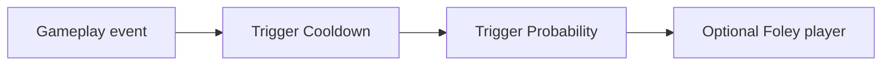

# QoL — small controls that clean up large graphs

These nodes deal mainly with **events and numbers**, not audio samples. Their purpose is to replace common branches, random checks and smoothing networks that would otherwise appear in every MetaSound.

**[Trigger Cooldown](nodes/qol/trigger-cooldown.md)** prevents rapid bursts from turning into dozens of audible events. **[Trigger Probability](nodes/qol/trigger-probability.md)** lets an event through at a configurable chance. Use them on optional rattles, contact ticks and other sounds that should not happen every time.

**[Float Smoother](nodes/qol/float-smoother.md)** prevents block-rate control values from stepping abruptly. This is useful for engine load, filtering and environmental controls.

**[Distance Switch (Dynamic)](nodes/qol/distance-switch.md)** routes a trigger to one distance band. It is a branching tool, whereas Distance Wave Player actually decodes recordings selected by distance.

## A useful pattern

The cooldown controls *frequency*, the probability controls *whether the optional detail happens*, and the player handles the recording. You can remove either control if it adds no value to the result.

[Browse the QoL reference](nodes/qol/README.md)
