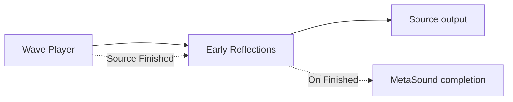

# Signals, events and the end of a sound

Many AudioPhysx graph problems aren't about decoding audio; they're about confusing **an event**, **an audio stream**, and **a lifecycle signal**. Understanding these three concepts will make every node easier to use.

## Triggers mark moments in time

`Play` means *start now*. `Stop` generally cancels playback. `Stop Firing` means *the held action has ended—play the release phase*. These commands are intentionally different. For example, the Start Loop End Player should normally receive a `Stop Firing` event so it can play the outro.

## Audio buffers continue between triggers

Once a recording is started, the MetaSound audio output carries samples every audio-processing block. A trigger pin is **not** a wire containing the sound. A separate `Out Mono` or `Audio` pin carries that sample stream.

## Completion belongs to the last audible stage

Consider this chain:

The original Wave Player can finish before the reflection taps have died away. If its `On Finished` directly ends the MetaSound Source, the reflection tail may be cut short. Route completion through the processor responsible for the last audible tail when it provides completion signals.

Similarly, **stopping intentionally** is not necessarily the same as **finishing naturally**. Don't assume every `Stop` will emit `On Finished`; check the particular player's documentation.

## Dynamic input groups

Some AudioPhysx nodes let you add more Wave slots, step arrays or distance ranges. The graph's pin layout is therefore part of the authored asset. Changing global Surface Audio routes can also change generated pins for [Surface Wave Player](../metasound/nodes/playback/surface-wave-player.md). Back up and inspect affected graphs after those settings change.

!!!warning Important for gameplay
A Source that loops forever should not be wired as though it has a natural ending after one recording. For held interactions, decide separately which event begins the sound, which event releases it, and what really marks the end of the audible result.
!!!

[Next: Choose the right player](../metasound/playback.md)
